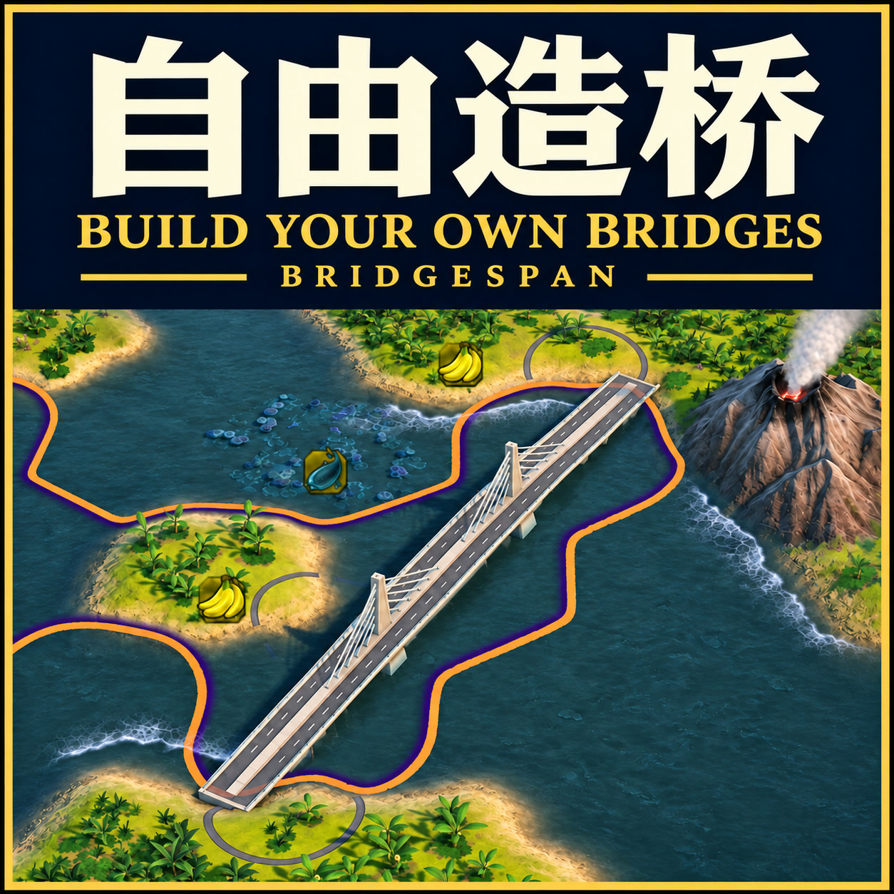

# BridgeSpan — Build Your Own Bridges

[简体中文](README.zh-CN.md) · **English** · [Steam Workshop](https://steamcommunity.com/sharedfiles/filedetails/?id=3838759919) · [Development & packaging](docs/DEVELOPMENT.md)

Build bridges across coast and lake tiles in Civilization VI. Land units and traders cross between the shores, while ships can pass through the water tiles below.

[](https://www.youtube.com/watch?v=GI03Ihe2g_Y)

[Watch the gameplay demo on YouTube](https://www.youtube.com/watch?v=GI03Ihe2g_Y): before/after routes, land and naval passage, and 1–3-tile bridges.

## Current release

[Download BridgeSpan v51 for manual installation](https://github.com/civs6-mods/BridgeSpan/releases/download/v51/BridgeSpan-v51.zip) · [All mod releases](https://github.com/civs6-mods/BridgeSpan/releases)

**v51 was released on November 20, 2026.** It fixes improvement placement, bridge entries in map tacks and search, and the display of internal bridge components in city details and reports.

- One-tile stone bridges and two-/three-tile sea bridges, built through city production. A city can build multiple bridges.
- The game chooses paths for land units, ships and traders, including entry, exit and embarkation at the side of a bridge.
- Pillaging any segment damages the entire bridge and removes its crossing components. Standard movement still applies. In testing, a Warrior walked onto a damaged bridge tile and a Galley sailed into the middle tile. City production repairs one bridge per district repair order, like a Canal. Each bridge in the same city has its own condition. When upgrading a Workshop v43 save, a partially damaged bridge becomes damaged along its full span.
- Multiple valid layouts use numbered options with bridge and A/B shore previews; a single valid layout goes straight to confirmation.
- Eligible feature and improvement removal is shown before construction. Cancelling leaves them intact.
- Supports the Windows Steam edition of Civilization VI, Gathering Storm, single-player, including Harmony in Diversity. See the [verification record](docs/VERIFICATION.md) for DX11/DX12 coverage.

Names, descriptions, in-game controls and messages support Simplified Chinese and English, following the game language.

## Installation & use

Subscribe on Steam Workshop, wait for the download to finish, and enable BridgeSpan in Additional Content. No external launcher is required.

For manual installation, exit the game and extract the release ZIP into `Documents/My Games/Sid Meier's Civilization VI/Mods`. Check that `Mods/BridgeSpan/BridgeSpan.modinfo` exists, then enable BridgeSpan in Additional Content. For an upgrade, replace the entire previous mod folder. Use one installation method: the local copy and Workshop subscription share the same mod ID.

Stone bridges require **Engineering** in the standard technology tree, or **Arch** with Harmony in Diversity. Sea bridges require **Steel**. Both types also require **Shipbuilding**. Select a bridge in city production, choose a valid water tile, and confirm the layout, cost and removal warnings.

The bridge must cross consecutive coast or lake tiles belonging to the same production city, with usable land at both ends. Bridge tiles cannot contain resources or other districts. Keep BridgeSpan enabled in saves containing its bridges.

## Repository layout

| Path | Contents |
| --- | --- |
| `mod/` | Complete v51 installable package: Lua, SQL, UI, and compiled art |
| `art/damage/` | Editable damaged Blender models, build scripts and resource templates for all three spans |
| `native/` | Historical game-core sources for v46 and earlier |
| `tests/` | Offline placement, picker, clearance, technology, damage and repair regressions |
| `scripts/` | Package verification, offline tests and ZIP packaging |
| `workshop/` | English, Simplified Chinese and combined descriptions, cover, screenshots and gallery order |
| `release-manifest.json` | SHA-256 hashes for the 66 v51 release files |

Quick verification and packaging:

```sh
python scripts/verify.py
npm ci
python scripts/test.py
python scripts/package.py
```

The ZIP is written to `dist/BridgeSpan-v51.zip`. See the [development guide](docs/DEVELOPMENT.md).

## Diagnostics

[Download the one-click diagnostics client](https://github.com/civs6-mods/BridgeSpan/releases/tag/diagnostics-v1.0.0). After encountering a problem, click **生成诊断包** (Create diagnostics package) and send the desktop ZIP plus an error screenshot to the author. Log selection is automatic; no installation or automatic upload. The current UI is in Simplified Chinese. [Source and details](support/diagnostics/README.md).

## Contributing

Use [Issues](https://github.com/civs6-mods/BridgeSpan/issues) for bug reports and feature suggestions. Pull requests for translations, testing, Lua / UI development, and bridge models or art are welcome.

Read the [development and packaging guide](docs/DEVELOPMENT.md) before starting. For reports, include the game version, ruleset, enabled mods, bridge screenshots and reproduction steps; a save from before the issue is especially useful. For pull requests, explain the purpose of the change and how it was verified, including the results.

## Feedback & license

For bug reports, include screenshots, reproduction steps and enabled mods. A save from before the issue helps.

Project code is [MIT licensed](LICENSE). MinHook retains its own license and attribution; see [third-party notices](native/THIRD_PARTY_NOTICES.txt).
