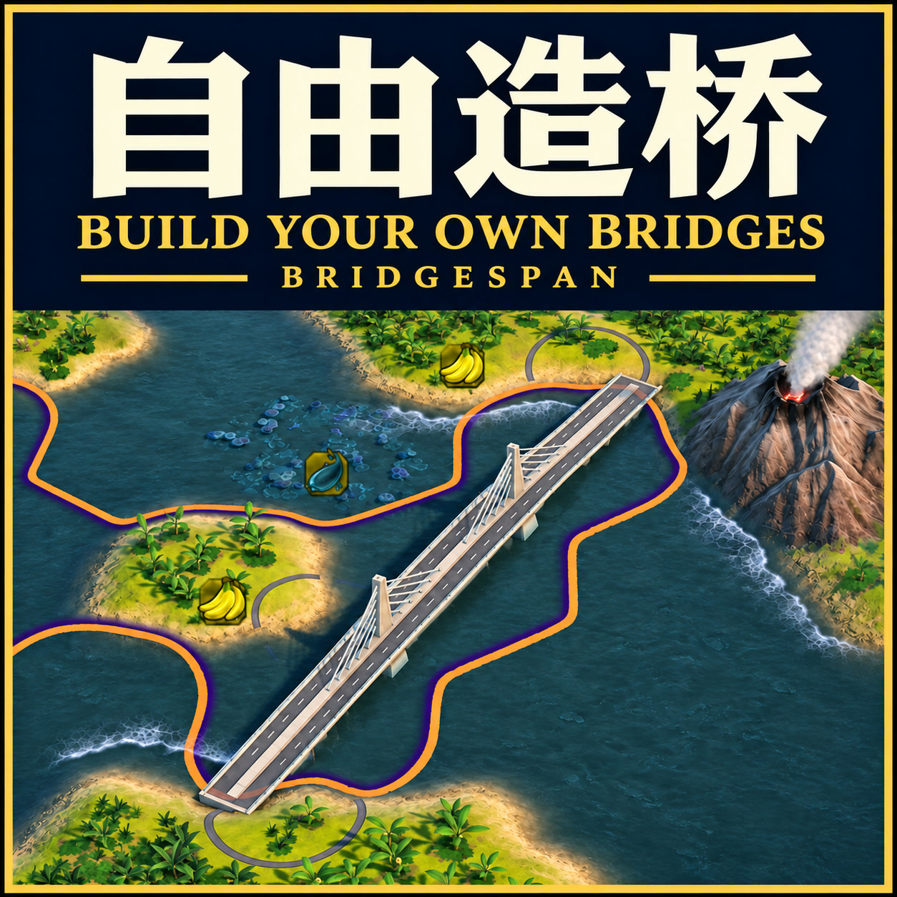

# BridgeSpan — Build Your Own Bridges

[简体中文](README.zh-CN.md) · **English** · [Steam Workshop](https://steamcommunity.com/sharedfiles/filedetails/?id=3838759919) · [Development & packaging](docs/DEVELOPMENT.md)

Build bridges across coast and lake tiles in Civilization VI. Land units and traders cross between the shores, while ships can pass through the water tiles below.

[](https://www.youtube.com/watch?v=GI03Ihe2g_Y)

[Watch the gameplay demo on YouTube](https://www.youtube.com/watch?v=GI03Ihe2g_Y): before/after routes, land and naval passage, and 1–3-tile bridges.

## Current release

**v45 is a local performance candidate.** The current Workshop release is v43. On one early-game save the next three turns took 4, 5 and 4 seconds with v45 and 39, 40 and 39 seconds with v44.

- One-tile stone bridges and two-/three-tile sea bridges, built through city production. A city can build multiple bridges.
- Land units and traders enter and leave at the two ends. Ships can cross the bridge's water tiles.
- Pillage damages only the occupied segment and updates its appearance. A city repair project restores every damaged segment of the selected bridge.
- Multiple valid layouts use numbered options with bridge and A/B shore previews; a single valid layout goes straight to confirmation.
- Eligible feature and improvement removal is shown before construction. Cancelling leaves them intact.
- Supports the Windows Steam edition of Civilization VI, Gathering Storm, single-player, including Harmony in Diversity. See the [verification record](docs/VERIFICATION.md) for DX11/DX12 coverage.

Names, descriptions, in-game controls and messages support Simplified Chinese and English, following the game language.

## Installation & use

Subscribe on Steam Workshop, wait for the download to finish, and enable BridgeSpan in Additional Content. No external launcher is required.

For manual installation, exit the game and copy the repository's `mod` folder into `Documents/My Games/Sid Meier's Civilization VI/Mods`, naming the copied folder `BridgeSpan`, then enable it. Use one installation method: the local copy and Workshop subscription share the same mod ID.

Stone bridges require **Engineering** in the standard technology tree, or **Arch** with Harmony in Diversity. Sea bridges require **Steel**. Both types also require **Shipbuilding**. Select a bridge in city production, choose a valid water tile, and confirm the layout, cost and removal warnings.

The bridge must cross consecutive coast or lake tiles belonging to the same production city, with usable land at both ends. Bridge tiles cannot contain resources or other districts. Keep BridgeSpan enabled in saves containing its bridges.

## Repository layout

| Path | Contents |
| --- | --- |
| `mod/` | Complete v45 installable package: Lua, SQL, UI, compiled art and native module |
| `art/damage/` | Editable damaged Blender models, build scripts and resource templates for all three spans |
| `native/` | Native C/C++ sources, MinHook sources and build entry point |
| `tests/` | Offline placement, picker, clearance, technology, damage and health regressions |
| `scripts/` | Package verification, offline tests and ZIP packaging |
| `workshop/` | English, Simplified Chinese and combined descriptions, cover, screenshots and gallery order |
| `release-manifest.json` | SHA-256 hashes for the 71 v45 release files |

Quick verification and packaging:

```sh
python scripts/verify.py
npm ci
python scripts/test.py
python scripts/package.py
```

The ZIP is written to `dist/BridgeSpan-v45.zip`. Native build requirements and commands are in the [development guide](docs/DEVELOPMENT.md).

## Diagnostics

[Download the one-click diagnostics client](https://github.com/civs6-mods/BridgeSpan/releases/tag/diagnostics-v1.0.0). After encountering a problem, click **生成诊断包** (Create diagnostics package) and send the desktop ZIP plus an error screenshot to the author. Log selection is automatic; no installation or automatic upload. The current UI is in Simplified Chinese. [Source and details](support/diagnostics/README.md).

## Contributing

Use [Issues](https://github.com/civs6-mods/BridgeSpan/issues) for bug reports and feature suggestions. Pull requests for translations, testing, Lua / UI development, and bridge models or art are welcome.

Read the [development and packaging guide](docs/DEVELOPMENT.md) before starting. For reports, include the game version, ruleset, enabled mods, bridge screenshots and reproduction steps; a save from before the issue is especially useful. For pull requests, explain the purpose of the change and how it was verified, including the results.

## Feedback & license

For bug reports, include screenshots, reproduction steps and enabled mods. A save from before the issue helps.

Project code is [MIT licensed](LICENSE). MinHook retains its own license and attribution; see [third-party notices](native/THIRD_PARTY_NOTICES.txt). No original game DLL is redistributed; the native module loads the locally installed game at runtime.
