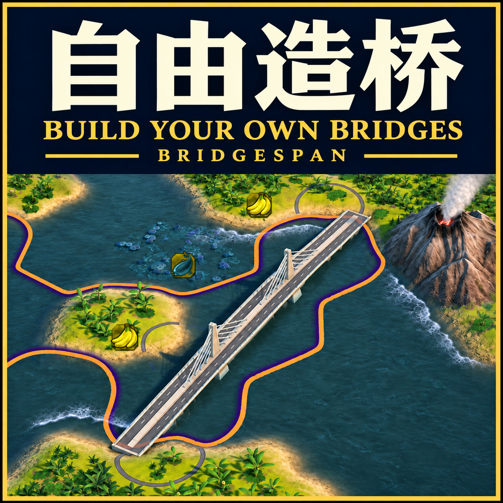

# BridgeSpan 自由造桥

在《文明 VI》的浅海和湖面上修桥，让陆军和商人从两岸通行，船只仍可穿过桥下水域。

[English](README.md) · [Steam 创意工坊](https://steamcommunity.com/sharedfiles/filedetails/?id=3838759919) · [开发与打包](docs/DEVELOPMENT.md)

[](https://www.youtube.com/watch?v=GI03Ihe2g_Y)

[观看实机演示（YouTube）](https://www.youtube.com/watch?v=GI03Ihe2g_Y)：修桥前后路径对比、水陆通行，以及 1～3 格桥梁效果。

## 当前版本

[直接下载自由造桥 v51 安装包](https://github.com/civs6-mods/BridgeSpan/releases/download/v51/BridgeSpan-v51.zip) · [查看历史版本](https://github.com/civs6-mods/BridgeSpan/releases)

**v51 已于 2026 年 11 月 20 日发布。** 本版修复改良设施选格和建造，合并重复的桥梁地图钉与搜索候选，并整理城市明细和收支报告中的内部桥梁组件。

- 1 格石桥，以及 2 格、3 格跨海大桥，由城市生产；同一城市可以建多座。
- 陆军、船只和商路都由游戏寻路，包括从桥身侧面离开或登船。
- 掠夺任意一格会损坏整座桥并移除各格的通行标记。受损后仍按原版规则移动。实测勇士可以走上受损桥格，桨帆船可以驶入桥身中间的水格。在城市生产面板使用区域维修，每完成一次修好一座桥。同城多座桥各自计算。载入工坊 v43 存档时，原来局部损坏的桥会转为整桥损坏。
- 多个合法桥位用方案列表选择，预览桥身及 A/B 两岸；只有一个方案时直接确认。
- 可移除的地貌、改良设施会在开工前提示，取消不会清理。
- 支持 Windows Steam《风云变幻》单人游戏，支持与《和而不同》搭配使用。DX11、DX12 的实测范围见[验收记录](docs/VERIFICATION.md)。

名称、简介、游戏内按钮与提示支持简体中文和英语，跟随游戏语言自动切换。

## 安装与使用

订阅工坊，等待下载完成，在“额外内容”启用即可使用完整功能，不需要外部启动器。

手动安装时，先退出游戏，将下载的 ZIP 解压到 `Documents/My Games/Sid Meier's Civilization VI/Mods`。确认文件路径为 `Mods/BridgeSpan/BridgeSpan.modinfo`，再到“额外内容”启用自由造桥。手动升级时请整体替换旧模组文件夹。工坊版和本地版使用同一模组 ID，请保留一种安装方式。

石桥在原版科技树需要“工程”，在《和而不同》中需要“拱券”；跨海大桥需要“钢铁”。两类桥都需要“造船术”。在城市生产面板选桥，点击合法水格，检查方案、费用和移除提示后确认。

桥身必须是属于同一座生产城市的连续浅海或湖面，两岸是可用陆地，不能占用资源或其他区域。建有桥梁的存档请保持模组启用。

## 仓库结构

| 路径 | 内容 |
| --- | --- |
| `mod/` | v51 完整可安装包，含 Lua、SQL、界面、编译美术资源 |
| `art/damage/` | 三种跨度的可编辑 Blender 受损模型、构建脚本和资源模板 |
| `native/` | v46 及更早版本使用的游戏核心源码 |
| `tests/` | 选址、方案面板、清理、科技解锁、损坏与维修的离线回归 |
| `scripts/` | 包完整性验证、离线测试与 ZIP 打包 |
| `workshop/` | 工坊中英文说明、封面、截图及顺序 |
| `release-manifest.json` | v51 的 66 个发布文件 SHA-256 清单 |

快速验证与打包：

```sh
python scripts/verify.py
npm ci
python scripts/test.py
python scripts/package.py
```

生成 `dist/BridgeSpan-v51.zip`。打包命令见[开发说明](docs/DEVELOPMENT.md)。

## 问题诊断

[下载一键诊断工具](https://github.com/civs6-mods/BridgeSpan/releases/tag/diagnostics-v1.0.0)：遇到问题后打开客户端，点击“生成诊断包”，将桌面的 ZIP 和报错截图发给作者即可。工具自动查找并整理日志，无需安装，不会自动上传。[源码与说明](support/diagnostics/README.md)。

## 参与开发

欢迎通过 [Issues](https://github.com/civs6-mods/BridgeSpan/issues) 提交 Bug 和功能建议，也欢迎通过 Pull Request 参与翻译、测试、Lua / UI 开发及桥梁模型美术。

开始前请阅读[开发与打包说明](docs/DEVELOPMENT.md)。反馈问题时请提供游戏版本、规则集、启用模组、桥位截图和复现步骤；有问题发生前的存档更好。提交改动时请说明修改目的、验证方式和结果。

## 反馈与许可

反馈时请附桥位截图、复现步骤和启用模组；有问题发生前的存档更好。

项目代码采用 [MIT](LICENSE)。MinHook 保留其独立许可证和署名，见 [第三方说明](native/THIRD_PARTY_NOTICES.txt)。
